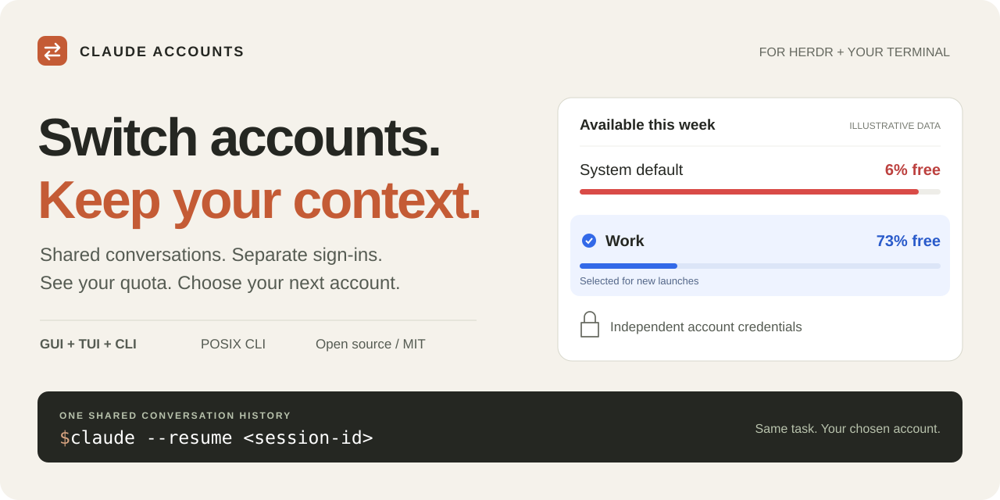

<p align="center">
  
</p>

<h1 align="center">Claude Code Account Switcher for Herdr</h1>

<p align="center">
  <strong>Multiple accounts. One conversation history.</strong><br />
  Switch Claude Code accounts, compare usage limits, and resume your work with the account you choose.<br />
  Native Herdr app · terminal UI · standalone CLI
</p>

<p align="center">
  <a href="https://github.com/andy-takker/herdr-claude-accounts/actions/workflows/ci.yml"></a>
  <a href="docs/compatibility.md"></a>
  <a href="docs/compatibility.md"></a>
  <a href="LICENSE"></a>
</p>

<p align="center">
  <a href="#quick-start">Quick start</a> ·
  <a href="#switch-accounts-and-resume-your-work">Switch &amp; resume</a> ·
  <a href="#installation">Herdr setup</a> ·
  <a href="#faq">FAQ</a> ·
  <a href="https://github.com/andy-takker/herdr-claude-accounts/issues">Feedback</a>
</p>

## Your account changes. Your work comes with you.

Already use separate Claude accounts for personal work, a team, or different
projects? Keep their sign-ins independent while choosing which account starts
your next Claude process. When you opt into shared history, your conversations
and project context are available across profiles.

**Herdr is optional.** The standalone CLI and terminal menu work in an ordinary
macOS terminal. No Python runtime dependencies, background daemon, or Orca
installation required.

| What you need | What you get |
| --- | --- |
| **Switch Claude accounts** | Browser sign-in once per profile; choose an account from the GUI, TUI or CLI. |
| **Continue the same task** | Opt-in shared history for `--resume` and `--continue`, with migration backups. |
| **Compare available usage** | Five-hour, weekly and model-specific quota windows, reset times and per-account refresh. |
| **Keep your setup** | Shared settings, skills, hooks, commands, project trust decisions and MCP definitions. |
| **See active sessions** | Collapsible session lists inside each account card; running processes keep their original account. |
| **Manage profiles** | Cancel sign-in, remove without erasing profile data, and restore removed accounts. |

Usage is cached for **5 minutes**. Shared status probes use a **15-second cache**.
Quota bars change from blue to yellow, orange and red at 70%, 80% and 90% used.
The illustration above uses fictional data; it is not a screenshot.

## Quick start

You need **macOS**, **Python 3.9+**, and a working **Claude Code** installation.
Keep the checkout in a permanent directory:

```sh
git clone https://github.com/andy-takker/herdr-claude-accounts.git
cd herdr-claude-accounts
python3 manager.py install-shell
```

Open a **new terminal**, then:

```sh
claude-accounts add Work       # Sign in through your browser
claude-accounts ui             # Select an account and inspect usage
```

Settings sharing is enabled by the installer. Conversation history sharing is
an explicit, separate step: read [Shared conversations](#shared-conversations),
then run `claude-accounts share-history` if you want one common history.

Want the native dialog or keyboard shortcut? Follow the
[Herdr app](#native-herdr-app) or [Herdr TUI](#herdr-tui) setup below.

## Switch accounts and resume your work

1. Exit the Claude process for the conversation you want to continue.
2. Open `claude-accounts ui` or the Herdr account menu. Compare available usage
   and select your next account.
3. In the same project directory, resume after enabling shared history:

   ```sh
   claude --resume SESSION_ID
   # Or continue the most recent conversation in this project:
   claude --continue
   ```

Check `/status` in Claude to confirm the account. A new process reads the current
selection; switching does not change the credentials of a process already running.
Old terminal tabs may need their PATH refreshed — see [Troubleshooting](#troubleshooting).

> **Shared context, separate credentials.** This is an account manager, not a
> way to increase an account's quota. Claude authentication, subscription limits
> and organization policies still apply. External MCP OAuth may need a separate
> sign-in for each profile.

## Installation

Requires macOS, Python 3.9+, and a working Claude Code installation. Herdr TUI
and Herdr app are different programs with different plugin systems. Install
only the integration you use, or both. See [tested versions](docs/compatibility.md).

### Core and shell launcher

Clone this repository into a **permanent directory**:

```sh
git clone https://github.com/andy-takker/herdr-claude-accounts.git
cd herdr-claude-accounts
python3 manager.py install-shell
```

The installer remembers the original `claude` executable, including an existing
proxy wrapper, and adds launchers for zsh and fish. It enables shared settings
and preserves the previous zsh configuration in a private backup. Open a new
terminal afterward. `command -v claude` should point to
`~/.local/share/herdr-claude-accounts/bin/claude`.

If needed, specify the original executable explicitly:

```sh
python3 manager.py install-shell --binary /absolute/path/to/original/claude
```

An alias or shell function named `claude` can bypass the launcher; installation
refuses known conflicting zsh/fish definitions. Other shells can add the same
launcher directory to PATH manually. Do not delete or move the checkout after
installation without updating the linked plugin and reinstalling the launchers.

### Herdr TUI

```sh
herdr plugin link "$PWD" --enabled
```

Merge this binding into `~/.config/herdr/config.toml`, preserving existing keys:

```toml
[[keys.command]]
key = "prefix+a"
type = "plugin_action"
command = "local.claude-accounts.open"
description = "Claude Accounts"
```

With the default prefix, press **Ctrl+B, release, then A** (without Shift).
Choose a different binding if it is already used. Apply with
`herdr server reload-config`, or Herdr's reload-config menu action.

The plugin action is also available from a Herdr terminal:

```sh
herdr plugin action invoke local.claude-accounts.open
```

For an ordinary terminal, use `claude-accounts ui`.

### Native Herdr app

After core installation, copy the mod:

```sh
mkdir -p ~/.config/herdr-app/mods/claude-accounts
cp herdr-app/main.js herdr-app/mod.json ~/.config/herdr-app/mods/claude-accounts/
```

Back up `~/.config/herdr-app/keys.json` if it exists. Merge the following into
its `global` object, retaining other bindings:

```json
{
  "global": {
    "cmd-shift-a": "mod.open:claude-accounts"
  }
}
```

**Cmd+Shift+A** opens the account dialog. The optional sidebar layout is in
`herdr-app/layout.json` with `herdr-app/preview.svg`: copy them to
`~/.config/herdr-app/layouts/claude-accounts.json` and
`~/.config/herdr-app/layouts/claude-accounts.svg`, then select that layout in
Herdr. It includes a clickable **Claude: …** account indicator. Back up any
existing custom layout with the same name before replacing it.

For an existing custom layout, add a block with
`content: {"mod":"claude-accounts","props":{"compact":true}}` and height 36.
No built-in Herdr files need modification.

### Shared conversations

Settings are shared during core installation. Conversation history requires a
separate, explicit migration:

```sh
claude-accounts share-history
```

The system `~/.claude` directory becomes the common context store. The migration
backs up original managed context, deduplicates identical history entries,
keeps compatible append-only transcript extensions, and refuses divergent files
rather than silently choosing one. Subsequent profiles use the same store.

If a managed account has running Claude processes, its existing files are
imported while directory replacement is deferred. The result lists those IDs
in `pending_profiles`. Finish those sessions normally and run
`claude-accounts share-history` again; ordinary launcher synchronization also
finishes pending migration after sharing has been enabled.

After switching accounts, start Claude in the same project and use `/resume`
or `claude --continue`. For another project, change directory or pass an
explicit transcript path to `--resume`. Keep one writer per conversation;
concurrent resumes can interleave transcript updates. Existing processes keep
the account with which they started.

## Keyboard shortcuts

| Key in the TUI | Action |
| --- | --- |
| Up / Down | Highlight an account |
| Enter | Select it for new launches |
| Space | Expand or collapse its active sessions |
| `u` | Refresh only this account's usage |
| `a` / `l` / `c` | Add / sign in again / cancel sign-in |
| `d` | Remove after confirmation; select System default |
| `o` | Removed profiles; Enter restores, `b` or Esc returns |
| `n` | Launch the highlighted account in a new Herdr tab |
| `s` / `r` | Select System default / refresh cached status |
| `v` | Confirm a short access check that uses quota |
| Page Up / Page Down | Scroll |
| `q` / Esc | Close the menu |

Outside Herdr, `n` temporarily runs Claude in the current terminal and returns
to the menu when it exits. The GUI exposes the same operations as buttons.
Browser cancellation stops only that login attempt; its browser tab may remain.

## CLI

```sh
claude-accounts add Work
claude-accounts list
claude-accounts select ACCOUNT_UUID
claude-accounts select system
claude-accounts status --usage
claude-accounts refresh-usage ACCOUNT_UUID
claude-accounts launch ACCOUNT_UUID --continue
claude-accounts remove ACCOUNT_UUID
claude-accounts removed
claude-accounts restore ACCOUNT_UUID
```

`add NAME --no-login` creates a profile for later sign-in. `login ACCOUNT_UUID`
repeats login. Most commands return JSON. Use `--help` for the full interface.
`python3 manager.py --root /absolute/path ...` selects a separate manager store;
Claude's System default still refers to that process's HOME.

## Data and privacy

Manager data lives in `~/.local/share/herdr-claude-accounts/` with private
permissions. Account folders are `profiles/<uuid>`; the manager stores names,
selection, sanitized status/usage, synchronization hashes and backups.

Claude owns authentication and token refresh. The manager does not copy OAuth
credentials or Keychain entries. Local "sign-in saved" is not proof of server
access. The explicit access check sends one short model request; normal status
and usage polling sends no model message. Usage uses Claude's control protocol,
which is version-dependent. Unknown or failed usage is never presented as zero.
The plugin sends no telemetry of its own; Claude retains its own behavior.

Shared context includes `projects`, `file-history`, `paste-cache`, `plans`,
`tasks`, `todos`, `agent-memory`, `image-cache`, `uploads` and `history.jsonl`.
Credentials, native `sessions/` process registries, daemon control keys and
runtime shell environments remain separate. Active-session counts describe
running processes, not every saved conversation in `/resume`.

Shared MCP definitions do not share external MCP OAuth credentials; a new
profile may still require `/mcp` sign-in. Configuration conflicts stop the
operation rather than discarding edits. Avoid editing configuration during
synchronization: ordinary editors do not honor Claude's lock protocol.

Backups may contain private conversations, settings or old identity metadata.
**Never upload the manager data directory or raw logs to an issue.** Removed
profiles and backups are retained deliberately; removal is not logout or
credential erasure. See [security policy](SECURITY.md).

## Update or disable

Update the source checkout, run `make check`, and reopen the TUI menu. For the
native app, copy the updated mod files again. When relocating the checkout,
run `python3 manager.py install-shell` from its new location and relink Herdr.

To disable shell/TUI integration:

```sh
claude-accounts uninstall-shell
herdr plugin unlink local.claude-accounts
```

Remove its TUI keybinding. In the native app, select another layout, remove the
custom mod/layout and its shortcut. Open a fresh terminal. Profiles, shared
history and backups remain; disabling the UI does not undo a history migration.

## Troubleshooting

- Menu missing: distinguish Herdr TUI configuration from native Herdr app configuration.
- Wrong account: check the launcher on PATH. An explicit `CLAUDE_CONFIG_DIR`
  overrides ordinary launches; `claude-accounts launch UUID|system` pins a profile.
- New terminals switch correctly but an old tab resumes with the old account:
  that shell may still have its pre-install PATH. Check `type -a claude`; the
  manager launcher must come first. In fish, run
  `source ~/.config/fish/conf.d/zzz-herdr-claude-accounts.fish`; in zsh, run
  `export PATH="$HOME/.local/share/herdr-claude-accounts/bin:$PATH"` and `rehash`.
  Exit the old Claude process before resuming. Alternatively, invoke
  `~/.local/share/herdr-claude-accounts/bin/claude --resume SESSION_ID` directly.
- Conflicting API/provider variables: managed claude.ai profiles refuse them.
  Use System default for your normal API/provider environment.
- Missing history: run the explicit migration and check `pending_profiles`.
  Resume in the original project directory.
- Usage unavailable: check login, CLI version and connectivity; manual refresh
  bypasses the five-minute usage cache for that account only.
- A failed add with a "profile retained" warning already created a profile.
  Resolve the settings conflict and sign into that row instead of adding again.

## FAQ

<details>
<summary><strong>Can I switch Claude Code accounts without losing my conversation?</strong></summary>

Yes, after enabling shared history. Exit the old Claude process, select the
next account and run `claude --resume SESSION_ID` from the same project. The
manager shares local conversation files; it does not swap credentials inside
an already running process. Keep one writer per conversation.

</details>

<details>
<summary><strong>Does this work without Herdr or Orca?</strong></summary>

Yes. Use `claude-accounts ui` in your terminal, or the standalone CLI. Herdr
adds the native app dialog, sidebar indicator and terminal overlay. Orca is
not required for creating or managing profiles.

</details>

<details>
<summary><strong>Will my settings and MCP servers follow me?</strong></summary>

Shared settings include supported user preferences, skills, hooks, commands,
project trust decisions and MCP definitions. External MCP OAuth credentials
remain separate, so some servers may ask you to sign in for a new profile.

</details>

<details>
<summary><strong>Does usage polling consume model tokens?</strong></summary>

Normal status and usage polling sends no model message. The separate
<strong>Check access</strong> action explicitly runs a short model request and
uses quota. Usage availability depends on Claude's control protocol.

</details>

<details>
<summary><strong>Are passwords or OAuth tokens stored in this repository?</strong></summary>

No. Claude manages authentication; private profile data lives outside the source
checkout. The manager does not copy OAuth credentials or Keychain entries
between accounts. Read [Data and privacy](#data-and-privacy) before sharing logs
or backups.

</details>

<details>
<summary><strong>Does it support Windows or Linux?</strong></summary>

The supported installation targets macOS. Backend tests also run on Linux CI;
that is not a claim of complete Linux desktop integration or Windows support.
See [Compatibility](docs/compatibility.md).

</details>

## Help other Claude Code users find it

If this solves your multi-account workflow, **star the repository** or share it
with someone who switches between Claude accounts. Found a rough edge?
[Open an issue](https://github.com/andy-takker/herdr-claude-accounts/issues/new/choose)
with redacted steps and versions. Contributions are welcome — start with
[CONTRIBUTING.md](CONTRIBUTING.md).

Built by [Sergey Natalenko / @andy-takker](https://github.com/andy-takker).
Also using OpenCode? See
[Subagents Sidebar](https://github.com/andy-takker/opencode-plugin-subagents-sidebar).

Independent community project; not affiliated with Anthropic or Herdr.

## Development

```sh
make check       # Python tests, native JS harness, whitespace check
make package     # archive the committed HEAD into dist/
```

Node 22+ is needed only for the JS test harness. There are no pip or npm runtime
dependencies. Tests use temporary stores, CLI doubles and pseudoterminals; they
do not log in to real accounts or send paid requests.

See [architecture](docs/architecture.md), [compatibility](docs/compatibility.md),
[release process](docs/releases.md), [changelog](CHANGELOG.md) and
[contribution guide](CONTRIBUTING.md). Licensed under [MIT](LICENSE).
